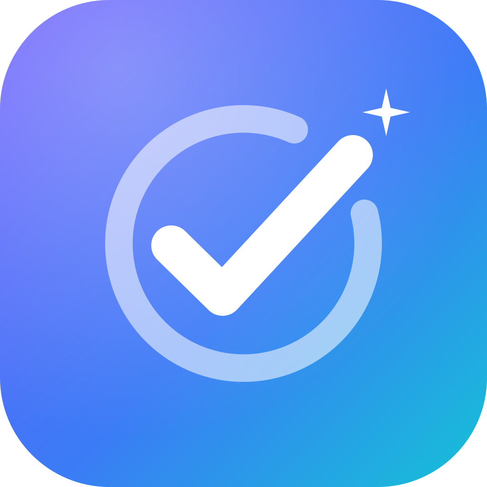
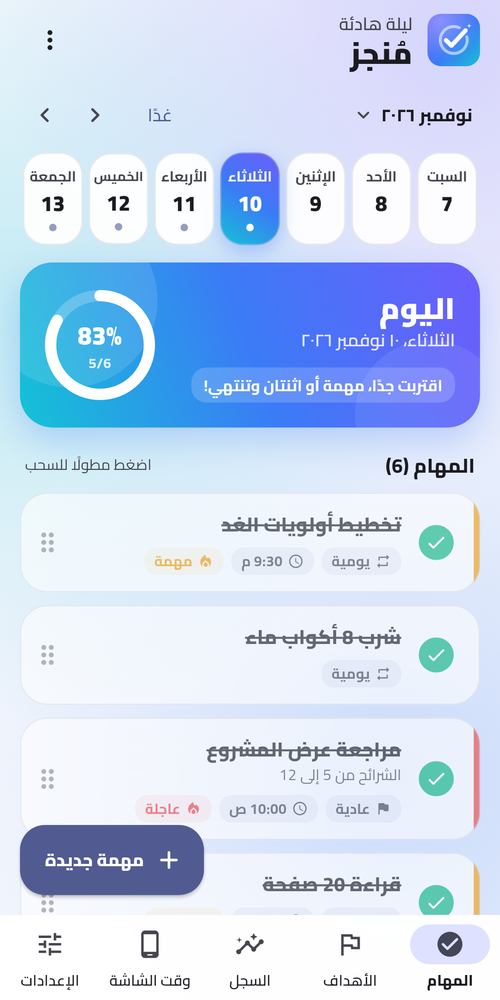
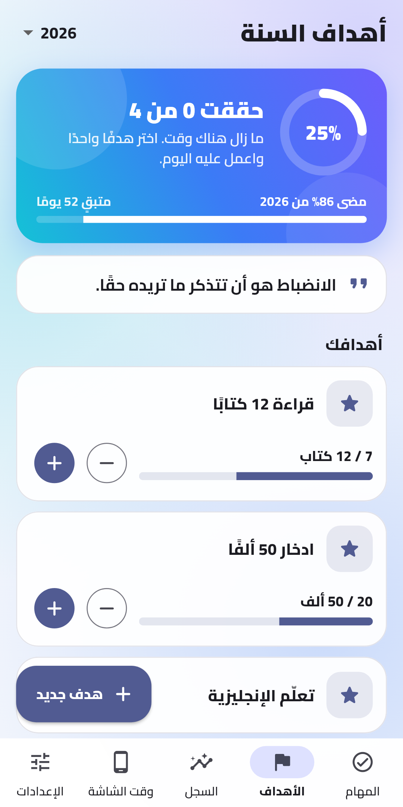
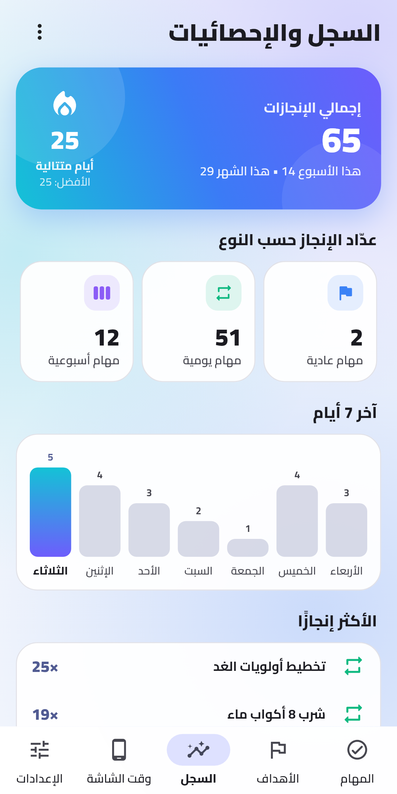
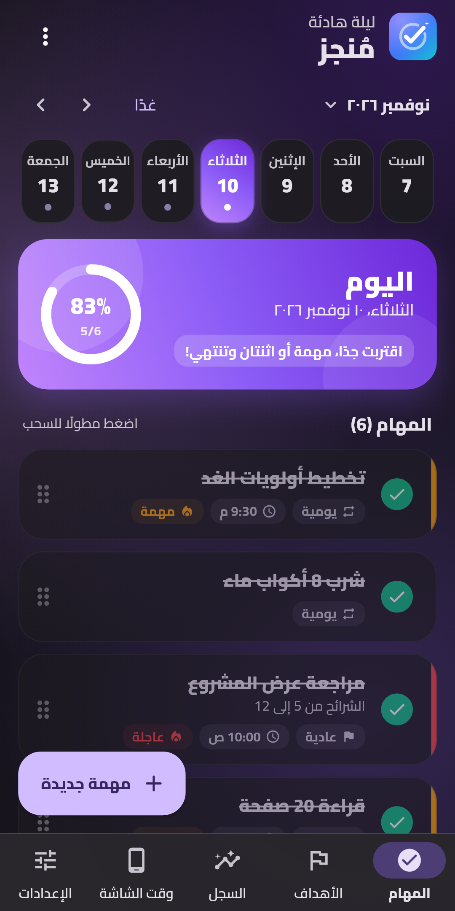

<div align="center">



# مُنجز · Mongez

**منظّم يومي مجاني ومفتوح المصدر لأندرويد، بالعربية بالكامل.**
<br>
خطّط يومك، وحافظ على استمراريتك، وتابع أهدافك السنوية ووقت الشاشة. بلا حساب ولا إعلانات ولا إنترنت.

[](https://github.com/AdamG00D/Mongez/releases/latest)
[](https://github.com/AdamG00D/Mongez/actions/workflows/flutter-ci.yml)
[](LICENSE)

**[English](README.en.md)** · [التحميل](#التحميل) · [المميزات](#المميزات) · [الخصوصية](#الخصوصية) · [المساهمة](#المساهمة)






</div>

<div dir="rtl">

## التحميل

نزّل أحدث نسخة من **[صفحة الإصدارات](https://github.com/AdamG00D/Mongez/releases/latest)**
(يعمل على أندرويد 7.0 فأحدث).

| الملف | لمن؟ |
| --- | --- |
| `Mongez-<الإصدار>-arm64-v8a.apk` | معظم الهواتف الحديثة (**الأنسب لأغلب الناس**) |
| `Mongez-<الإصدار>-armeabi-v7a.apk` | الهواتف القديمة (32 بت) |
| `Mongez-<الإصدار>.apk` | نسخة عامة تعمل على أي جهاز، لكن حجمها أكبر |

**طريقة التثبيت:** افتح الملف من الهاتف، ووافق على «التثبيت من هذا المصدر» عند السؤال.

> [!IMPORTANT]
> **عندك الإصدار 2.0.1 أو أقدم؟** مفتاح توقيع التطبيق تغيّر، فلن يتحدث التطبيق القديم مباشرة.
> خذ نسخة احتياطية أولًا (الإعدادات ← البيانات ← حفظ نسخة احتياطية)، ثم احذف التطبيق القديم، وثبّت الجديد، واسترجع النسخة.

على أندرويد 13 فأحدث، إذا ظهرت رسالة “Controlled by restricted setting” (أو ما يقابلها بلغة هاتفك) عند تفعيل وقت الشاشة، افتح
معلومات التطبيق ← ⋮ ← «السماح بالإعدادات المحظورة». التطبيق يشرح لك الخطوات.

## المميزات

- **المهام:** مهام لمرة واحدة ويومية وأسبوعية، مع الأولوية والملاحظات ووقت التذكير.
  ترتيب بالسحب، وفرز حسب الوقت أو الأولوية، وسحب المهمة لإنجازها أو حذفها (مع تراجع)،
  وتأجيل، ونسخ للغد، ونقل المهام غير المنجزة.
- **المهام الأسبوعية:** تختار أول يوم في الأسبوع، وطريقة «ذكّرني حتى أنجزها».
- **السجل والإحصائيات:** سجل إنجازات لا يضيع عند حذف المهمة، وعدّادات لكل نوع، وأيام متتالية،
  ورسم بياني لآخر 7 أيام، وأكثر المهام إنجازًا. ويمكنك حذف أي إنجاز منه، أو كل إنجازات مهمة، أو السجل كله.
- **الأهداف السنوية:** أهداف بمراحل أو بأرقام، مع مقارنة تقدّمك بما مضى من السنة، وتحفيز أسبوعي.
- **وقت الشاشة:** مدة تشغيل الشاشة، ومرات فتح الهاتف، واستخدام كل تطبيق، وحد يومي للتطبيقات التي تختارها.
  البيانات لا تغادر جهازك.
- **التذكيرات:** إشعارات في موعدها بالضبط (حتى والتطبيق مفتوح) مع زر «تم الإنجاز ✓»، ومتابعة للمهام غير المنجزة،
  وتذكير مسائي لتخطيط الغد.
- **الشكل:** 9 ثيمات ألوان، فاتح / داكن / أسود AMOLED، وخلفيات جاهزة أو من صورك، واحتفال بالصوت عند الإنجاز.
- **ويدجت للشاشة الرئيسية:** قائمة المهام، وملخص اليوم.
- **نسخ احتياطي واسترجاع** في ملف JSON. يعمل بالكامل بدون إنترنت.

## الخصوصية

لا حساب، ولا إعلانات، ولا أدوات تتبّع، والتطبيق لا يطلب صلاحية الإنترنت أصلًا.
التفاصيل في [سياسة الخصوصية](PRIVACY.md).

## المساهمة

المساهمات مرحّب بها بالعربية أو الإنجليزية:

- **وجدت مشكلة؟** افتح [بلاغًا جديدًا](https://github.com/AdamG00D/Mongez/issues/new/choose) واذكر خطوات حدوثها ونوع هاتفك.
- **عندك فكرة؟** اقترحها من قالب «Feature request».
- **تريد المساهمة بالكود؟** اقرأ [دليل المساهمة](CONTRIBUTING.md) و[قواعد السلوك](CODE_OF_CONDUCT.md).
  التعليمات التقنية (التشغيل، والبناء، وبنية المشروع) موجودة في [README بالإنجليزية](README.en.md#getting-started).
- **ثغرة أمنية؟** أبلغ عنها بشكل خاص كما في [SECURITY.md](SECURITY.md).

### تشغيل المشروع بسرعة

</div>

```bash
git clone https://github.com/AdamG00D/Mongez.git
cd Mongez
flutter pub get
flutter run
```

<div dir="rtl">

## الترخيص

[GPL-3.0](LICENSE) © AdamG00D والمساهمون. يمكنك استخدام الكود وتعديله وتوزيعه، بشرط أن يبقى أي عمل مشتق
مفتوح المصدر بنفس الترخيص.

</div>
